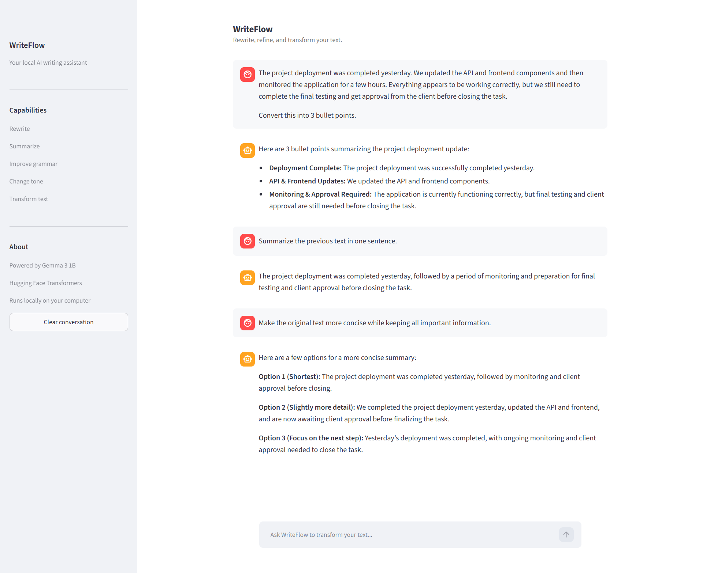
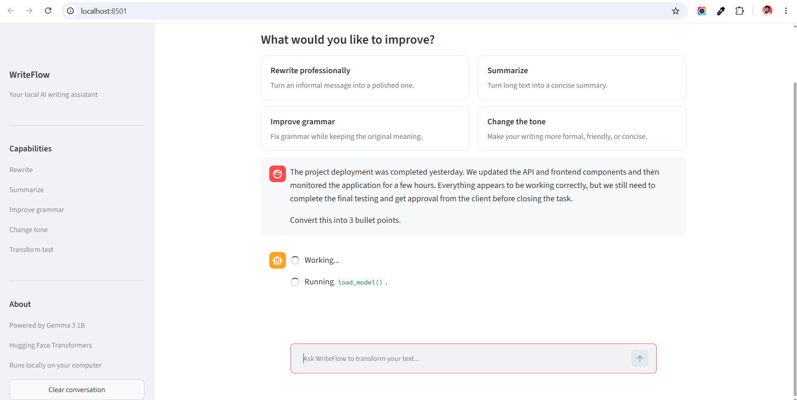

# WriteFlow

A lightweight local AI writing assistant built with Streamlit, Hugging Face Transformers, and Google's Gemma 3 1B Instruct model.

WriteFlow is designed around focused text transformation rather than general-purpose chat. It can be used for rewriting, summarizing, grammar improvement, tone changes, and other short text-editing tasks while keeping the model and inference process on the local machine.

## Screenshots

### Text transformation



### Application interface



## Features

- Chat-style writing assistant
- Professional rewriting
- Summarization
- Grammar improvement
- Tone transformation
- Context-aware follow-up requests
- Local model inference
- Clean Streamlit interface
- Conversation history within the current session
- No external AI API required

## Technology

| Component | Technology |
| --- | --- |
| UI | Streamlit |
| Model runtime | Hugging Face Transformers |
| ML framework | PyTorch |
| Model | Google Gemma 3 1B Instruct |
| Model ID | `google/gemma-3-1b-it` |
| Inference | Local CPU |

Model: https://huggingface.co/google/gemma-3-1b-it

## How it works

```text
User
  │
  ▼
Streamlit chat interface
  │
  ▼
Python application
  │
  ▼
Hugging Face Transformers
  │
  ▼
Gemma 3 1B Instruct
  │
  ▼
Local response
```

On the first run, Transformers downloads the model from the Hugging Face Hub and stores it in the local Hugging Face cache. Later runs reuse the cached model.

The model is not stored in this Git repository.

## Requirements

- Python 3.10+
- A machine with enough RAM for Gemma 3 1B
- A Hugging Face account with access to Gemma
- Windows, macOS, or Linux

## Setup

Clone the repository and enter the project directory:

```bash
git clone <your-repository-url>
cd huggingface-gemma
```

Create the virtual environment:

```bash
python -m venv .venv
```

Activate it on Windows:

```powershell
.venv\Scripts\activate
```

Install the dependencies:

```powershell
pip install -r requirements.txt
```

Authenticate with Hugging Face:

```powershell
hf auth login
```

Accept the Gemma usage terms on the model page before the first run:

https://huggingface.co/google/gemma-3-1b-it

Start the application:

```powershell
streamlit run app.py
```

Open the local URL shown by Streamlit, normally:

```text
http://localhost:8501
```

## Example

Input:

```text
The project deployment was completed yesterday. We updated the API and frontend components and then monitored the application for a few hours. Everything appears to be working correctly, but we still need to complete the final testing and get approval from the client before closing the task.
```

You can then ask:

```text
Convert this into 3 bullet points.
```

Follow-up requests can use the previous conversation context, for example:

```text
Summarize the previous text in one sentence.
```

## Local model cache

The Gemma model is downloaded only when it is first needed. Transformers stores the downloaded files in the Hugging Face cache rather than inside this project.

To inspect the cache:

```powershell
hf cache ls
```

After experimenting, the Gemma cache can be removed without deleting the project:

```powershell
hf cache rm model/google/gemma-3-1b-it
```

## Limitations

WriteFlow is intentionally built around a small 1B-parameter model running locally on CPU. Response quality, reasoning ability, context handling, and generation speed are therefore more limited than larger hosted models.

The application is intended as a lightweight local inference project and demonstration of the Hugging Face Transformers workflow.

## Project structure

```text
huggingface-gemma/
├── app.py
├── requirements.txt
├── README.md
├── .gitignore
└── screenshots/
    ├── writeflow-interface.png
    └── writeflow-conversation.png
```

## License

This project code can be used as a personal learning and portfolio project. The Gemma model is provided by Google under its own applicable terms. Refer to the model page for the current model terms and license.
